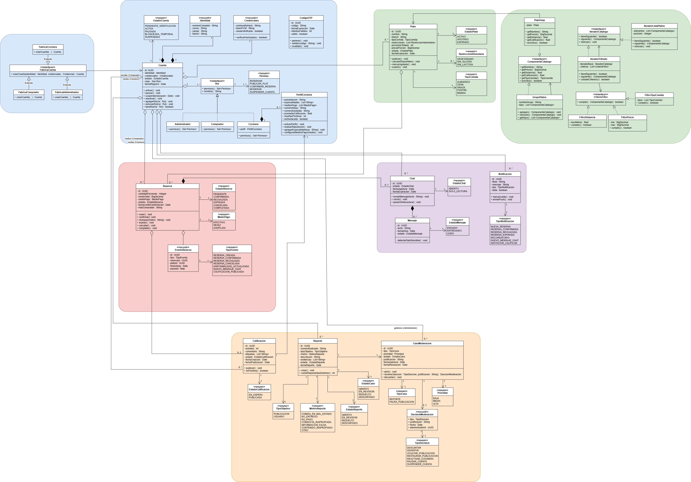
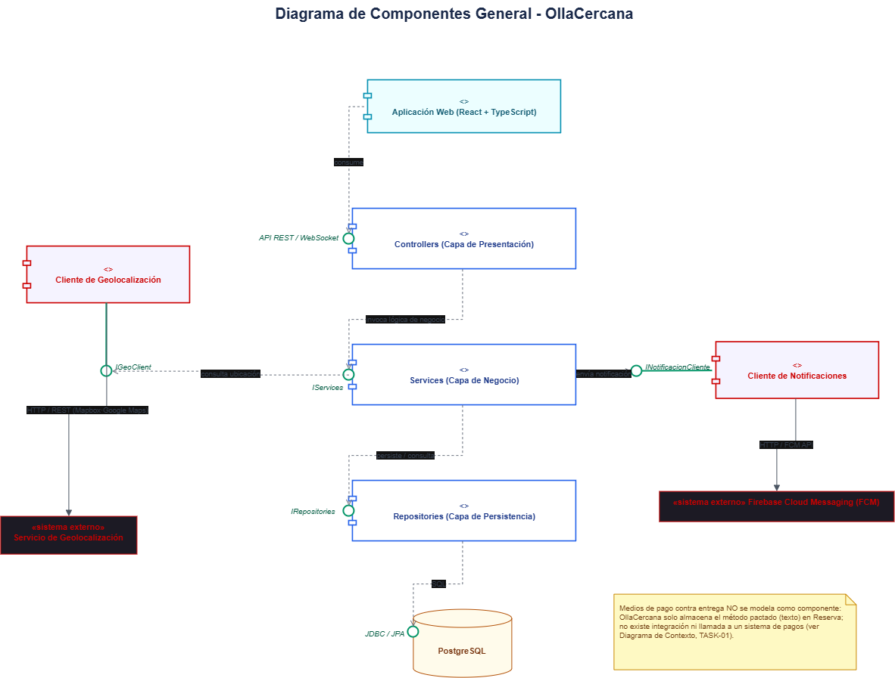
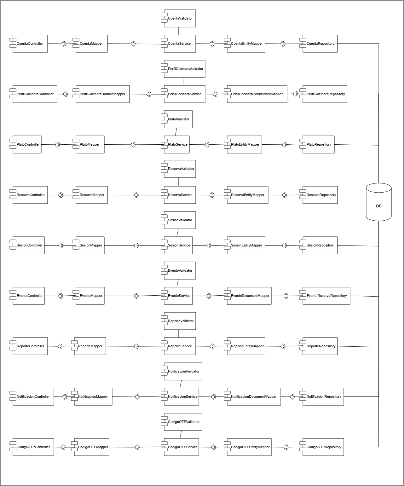
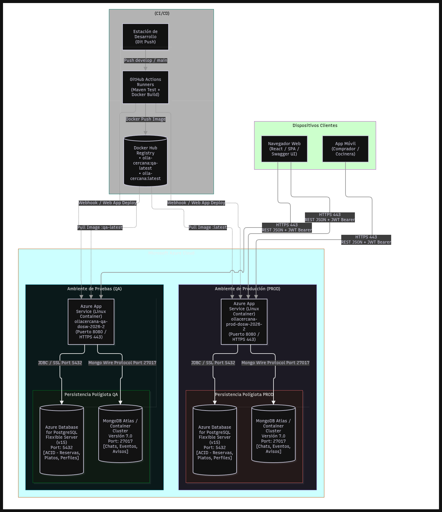

# OllaCercana — Backend API

Plataforma hiperlocal que conecta cocineras tradicionales en conjuntos residenciales con vecinos que buscan comida casera del día. El sistema gestiona ofertas de platos diarios, pedidos con control estricto de disponibilidad, mensajería interna, calificaciones comunitarias y un módulo de moderación y auditoría.

---

## Enlaces de Despliegue en la Nube (Azure)

Los servicios se encuentran desplegados mediante contenedores Docker en **Azure App Service**:

* **Ambiente de QA (Swagger UI):**  
   [https://ollacercana-qa-dosw-2026-2.azurewebsites.net/swagger-ui/index.html](https://ollacercana-qa-dosw-2026-2.azurewebsites.net/swagger-ui/index.html)
* **Ambiente de Producción (PROD - Swagger UI):**  
   [https://ollacercana-prod-dosw-2026-2.azurewebsites.net/swagger-ui/index.html](https://ollacercana-prod-dosw-2026-2.azurewebsites.net/swagger-ui/index.html)

---

##  Tabla de Contenidos

1. [Descripción del Proyecto](#descripción-del-proyecto)
2. [Stack Tecnológico](#stack-tecnológico)
3. [Ejecución de Pruebas Unitarias y Cobertura](#ejecución-de-pruebas-unitarias-y-cobertura)
4. [Instrucciones para Levantar Localmente](#instrucciones-para-levantar-localmente)
5. [Variables de Entorno](#variables-de-entorno)
6. [Estructura del Proyecto](#estructura-del-proyecto)
7. [Arquitectura y Diagramas del Sistema](#arquitectura-y-diagramas-del-sistema)
8. [Decisión de Persistencia Políglota](#decisión-de-persistencia-políglota)
9. [Patrones de Diseño Implementados](#patrones-de-diseño-implementados)
10. [Matriz de Roles y Permisos (Seguridad JWT)](#matriz-de-roles-y-permisos-seguridad-jwt)
11. [Reglas de Negocio Implementadas](#reglas-de-negocio-implementadas)
12. [Pipeline de Integración y Despliegue Continuo (CI/CD)](#pipeline-de-integración-y-despliegue-continuo-cicd)
13. [Equipo de Desarrollo](#equipo-de-desarrollo)

---

##  Descripción del Proyecto

OllaCercana resuelve el problema de acceso a alimentación casera, económica y cercana en unidades residenciales, formalizando la economía de cocineras de barrio. Ofrece:
* **Catálogo geolocalizado:** Búsqueda en radio configurable (500m - 2000m) protegiendo la privacidad de la cocinera (ofuscación determinística de coordenadas a múltiplos de 100m, RN-05).
* **Ciclo de reservas transaccional:** Control estricto de stock con bloqueo optimista (`@Version`), expiración automática a los 10 minutos (RN-04) y cierre a las 24 horas.
* **Seguridad sin estado:** Autenticación JWT con roles (`COMPRADOR`, `COCINERA`, `ADMIN`).
* **Interacción comunitaria:** Historial de chat por reserva con retención de 30 días y sistema de calificaciones recíprocas protegidas por ventana ciega de 72 horas.
* **Moderación:** Flujo en cadena para ocultamiento preventivo ante reportes reiterados (RN-22) y auditoría de decisiones administrativas (RN-23).

---

##  Stack Tecnológico

* **Lenguaje:** Java 21 (LTS)
* **Framework:** Spring Boot 3.2.5
* **Seguridad:** Spring Security 6 + JJWT 0.12.3 (HMAC-SHA256, BCrypt)
* **Persistencia Relacional:** Spring Data JPA + PostgreSQL 15 (Datos transaccionales estructurados)
* **Persistencia NoSQL:** Spring Data MongoDB 7.0 (Chat, auditoría de eventos y notificaciones in-app)
* **Documentación API:** SpringDoc OpenAPI 2.5.0 / Swagger UI
* **Mapeo y Utilidades:** MapStruct 1.5.5.Final, Lombok
* **Contenedores:** Docker (construcción multietapa) & Docker Compose
* **Pruebas:** JUnit 5, Mockito, H2 Database (modo PostgreSQL para test)
* **Calidad y Cobertura:** JaCoCo 0.8.12, SonarQube Scanner
* **CI/CD & Cloud:** GitHub Actions, Docker Hub, Azure App Service, Azure Database for PostgreSQL

---

##  Ejecución de Pruebas Unitarias y Cobertura

El proyecto cuenta con una batería integral de pruebas unitarias y de integración que cubren controladores, servicios, validadores, mapeadores y seguridad bajo el patrón **AAA (Arrange, Act, Assert)**:

### Ejecutar las pruebas localmente:
```bash
mvn clean test
```

### Generar reporte de cobertura con JaCoCo:
```bash
mvn jacoco:report
```
El reporte HTML generado se encontrará en: `target/site/jacoco/index.html`.

> **Métricas de Calidad:**
> * Pruebas unitarias ejecutadas: **100% pasando en verde**.
> * Cobertura de lógica de negocio (servicios y validadores): **> 85%**.
> * SonarQube: Exclusiones configuradas para DTOs, configuraciones y modelos de solo datos.

---

##  Instrucciones para Levantar Localmente

### Requisitos previos:
* Docker Engine 24+ y Docker Compose v2+
* Git

### Pasos:

1. **Clonar el repositorio:**
   ```bash
   git clone https://github.com/tu-usuario/olla-cercana.git
   cd olla-cercana
   ```

2. **Configurar el entorno:**
   Copia el archivo de variables de ejemplo:
   ```bash
   cp .env.example .env
   ```

3. **Compilar y levantar todos los contenedores:**
   ```bash
   docker compose up --build -d
   ```
   *Esto levantará:*
    * PostgreSQL en el puerto `5432`
    * MongoDB en el puerto `27017`
    * Backend Spring Boot en el puerto `8080`

4. **Verificar el servicio:**
   Abre tu navegador en: [http://localhost:8080/swagger-ui/index.html](http://localhost:8080/swagger-ui/index.html)

5. **Detener los servicios:**
   ```bash
   docker compose down -v
   ```

---

##  Variables de Entorno

La aplicación se parametriza mediante variables de entorno (definidas en `.env` localmente o en los App Settings de Azure):

| Variable | Descripción | 
| :--- | :--- | 
| `SERVER_PORT` | Puerto de escucha del servidor |
| `DB_URL` | URL JDBC de conexión a PostgreSQL |
| `DB_USERNAME` | Usuario de PostgreSQL | 
| `DB_PASSWORD` | Contraseña de PostgreSQL | 
| `MONGO_URI` | Cadena de conexión para MongoDB | 
| `JWT_SECRET` | Clave secreta Base64 (mínimo 256 bits) | 
| `JWT_EXPIRATION_MS` | Tiempo de vida del token JWT en milisegundos | 
| `OLLACERCANA_MAPA_OFUSCACION_SALT` | Sal secreta para el algoritmo de ofuscación geográfica | 

---

##  Estructura del Proyecto

El código implementa una arquitectura limpia hexagonal/en capas desacoplada:

```text
src/main/java/com/ollacercana/
├── config/              # Seguridad JWT, OpenAPI, Schedulers y JPA/Mongo
│   ├── scheduler/       # Tareas programadas (expiración, purga de chats, etc.)
│   └── security/        # Filtros JWT, UserDetailsService, Handlers de acceso
├── controller/          # Controladores REST
│   ├── docs/            # Interfaces Swagger/OpenAPI separadas de la lógica
│   ├── dtos/            # Records y DTOs de Request y Response
│   ├── handlers/        # GlobalExceptionHandler y excepciones de negocio
│   └── mappers/         # Conversores MapStruct/Spring Dominio ↔ DTO
├── core/                # Capa Central de Negocio (Pura, sin dependencias JPA)
│   ├── models/          # Entidades y Agregados de Dominio
│   ├── patterns/        # Implementación de Patrones GoF (Factory, Observer, Chain, etc.)
│   ├── services/        # Interfaces e implementaciones de Servicios de Dominio
│   ├── util/            # GeoUtils (Haversine y ofuscación determinística)
│   └── validators/      # Validadores de invariantes de negocio
└── persistence/         # Capa de Infraestructura y Persistencia
    ├── document/        # Documentos de MongoDB
    ├── entities/        # Entidades relacionales JPA de PostgreSQL
    ├── mappers/         # Conversores Dominio ↔ Entidad JPA / Documento Mongo
    └── repository/      # Repositorios JPA y MongoRepository
```

---

##  Arquitectura y Diagramas del Sistema

### 1. Diagrama de Clases
Muestra las entidades del núcleo de dominio (`Cuenta`, `Plato`, `Reserva`, `Calificacion`, `Reporte`) y su independencia de frameworks externos:


### 2. Diagrama de Componentes General (C4 Nivel 2)
Interacción entre clientes (Web / Mobile), Backend API Gateway, Bases de Datos PostgreSQL y MongoDB:


### 3. Diagrama de Componentes Específico (Estructura Interna)
Desacoplamiento entre capa Web, Aplicación/Dominio y Persistencia mediante Interfaces y Mappers:


### 4. Diagrama de Despliegue en Azure
Flujo de entrega continua desde GitHub hacia Docker Hub y ejecución en ambientes aislados de Azure (QA y Producción):


### 5. Diagrama de Base de Datos y Persistencia
Modelo relacional estructurado para consistencia ACID en transacciones financieras y de reservas, complementado con colecciones documentales para trazabilidad y chat:


---

##  Decisión de Persistencia Políglota

La arquitectura utiliza un esquema **híbrido relacional + documental**:

1. **PostgreSQL (JPA / Hibernate):**
    * **Por qué:** Las reservas, perfiles, cuentas y calificaciones requieren estricto cumplimiento **ACID**, relaciones foráneas consistentes y control de concurrencia optimista (`@Version` en `PlatoEntity` y `ReservaEntity`) para impedir sobreventas de porciones o reservas duplicadas en milisegundos.
2. **MongoDB:**
    * **Por qué:** Utilizado para **eventos de reserva**, **mensajería de chat** y **notificaciones in-app**. Estos datos tienen esquemas semiestructurados, alta tasa de escritura por segundo y ciclos de vida independientes (por ejemplo, purga programada de mensajes de chat tras 30 días, RN-18).

---

##  Patrones de Diseño Implementados

| Patrón | Problema que Resuelve | Clase / Interfaz Concreta | Ubicación en Diagrama |
| :--- | :--- | :--- | :--- |
| **Factory Method** | Centraliza la creación e inicialización de cuentas garantizando invariantes por rol (`COMPRADOR`, `COCINERA`, `ADMIN`). | `CuentaFactoryRegistry`, `FabricaComprador`, `FabricaCocinera`, `FabricaAdministrador` | `core.patterns.factory` |
| **Observer** | Desacopla la publicación de eventos de reserva de las reacciones del sistema (auditoría, notificaciones in-app, medallas). | `PublicadorEventosReserva`, `NotificacionInAppObservador`, `AuditoriaEventoObservador`, `MedallaObservador` | `core.patterns.observer` |
| **Observer (Interno)** | Notifica en tiempo real la variación del stock de porciones disponibles tras reservas o cancelaciones. | `PublicadorEventosPorciones`, `PorcionesActualizadasObservador`, `NotificadorPorcionesImpl` | `core.patterns.observer` |
| **Chain of Responsibility** | Evalúa en cadena secuencial la validez de publicación de un plato (Cocinera habilitada → Rango de precio → Límite activos). | `ValidadorPlatoHandler`, `CocineraHabilitadaHandler`, `PrecioPlatoHandler`, `LimitePlatosActivosHandler` | `core.validators.chain` |
| **Chain of Responsibility** | Modera automáticamente reportes sobre platos o usuarios aplicando ocultamiento preventivo y asignación a admin. | `ModeracionReporteHandler`, `ValidadorReporteHandler`, `OcultamientoPreventivoHandler`, `RevisorAdministradorHandler` | `core.patterns.moderacion` |
| **Iterator / Composite / Filter** | Permite recorrer y combinar dinámicamente filtros del catálogo (tipo de comida, distancia Haversine, restricciones dietarias). | `CatalogoIterator`, `FiltroCompuestoPlato`, `FiltroDistanciaMaxima`, `FiltroRestricciones` | `core.patterns.iterator` & `core.patterns.filter` |

---

##  Matriz de Roles y Permisos (Seguridad JWT)

Todos los endpoints (salvo autenticación y catálogo público) exigen token Bearer en el encabezado `Authorization: Bearer <token>`:

| Endpoint | Método | Roles Permitidos | Descripción / Regla |
| :--- | :---: | :--- | :--- |
| `/api/v1/sesiones` | `POST` | *Público* | Autenticación con credenciales; emite JWT con claims |
| `/api/v1/cuentas` | `POST` | *Público* | Registro de cuenta nueva con contraseña BCrypt |
| `/api/v1/cuentas/{id}/avisos` | `PATCH` | `COMPRADOR`, `COCINERA` | Modificar preferencias de avisos in-app |
| `/api/v1/perfiles` | `POST` | `COCINERA`, `ADMIN` | Creación de perfil con medios de pago y conjunto |
| `/api/v1/perfiles/{id}` | `PUT` | `COCINERA`, `ADMIN` | Actualización de perfil de cocinera |
| `/api/v1/perfiles/{id}/verificar-telefono` | `POST` | `COCINERA`, `ADMIN` | Verificación de teléfono mediante código OTP |
| `/api/v1/perfiles/cuenta/{cuentaId}` | `GET` | *Autenticado* | Consulta de perfil de la cuenta activa |
| `/api/v1/perfiles/destacadas` | `GET` | *Público* | Listado de cocineras con más de 50 reseñas positivas (RN-10) |
| `/api/v1/platos/cercanos` | `GET` | *Público* | Consulta paginada por distancia y menú sin exponer dirección (RN-05) |
| `/api/v1/platos/{id}` | `GET` | *Público* | Detalle del plato y medios de pago que acepta la cocinera |
| `/api/v1/platos` | `POST` | `COCINERA` | Publicar oferta del día (máx. 3 activas, RN-28) |
| `/api/v1/platos/{id}/disponibilidad` | `PATCH` | `COCINERA` | Ajuste manual de stock con bloqueo optimista |
| `/api/v1/platos/{id}` | `DELETE` | `COCINERA`, `ADMIN` | Eliminar oferta (solo cocinera titular o admin) |
| `/api/v1/cocineras/mapa` | `GET` | *Público* | Consulta de mapa con coordenadas ofuscadas a 100m (RN-05) |
| `/api/v1/reservas` | `POST` | `COMPRADOR` | Apartar porciones (RN-03, RN-14, RN-15) |
| `/api/v1/reservas/pendientes` | `GET` | `COCINERA` | Solicitudes entrantes dentro del límite de 10 min |
| `/api/v1/reservas/{id}` | `GET` | *Autenticado* | Consulta de reserva (solo partes involucradas o admin) |
| `/api/v1/reservas/{id}/decision` | `PATCH` | `COCINERA` | Aceptar (con hora estimada) o rechazar con motivo (RN-04) |
| `/api/v1/reservas/{id}/completar` | `POST` | `COMPRADOR`, `COCINERA` | Cierre de entrega y pago contra entrega (RN-32) |
| `/api/v1/reservas/{id}/mensajes` | `POST` | `COMPRADOR`, `COCINERA` | Envío de mensajes en chat activo (RN-17) |
| `/api/v1/reservas/{id}/mensajes` | `GET` | `COMPRADOR`, `COCINERA` | Consulta de chat con soporte de polling (`?desde`) |
| `/api/v1/reservas/{id}/mensajes/leidos` | `PATCH` | `COMPRADOR`, `COCINERA` | Marcar mensajes recibidos como leídos |
| `/api/v1/reservas/{id}/mensajes/no-leidos` | `GET` | `COMPRADOR`, `COCINERA` | Conteo de mensajes pendientes por leer |
| `/api/v1/reservas/{reservaId}/calificacion` | `POST` | `COMPRADOR` | Calificar reserva completada (RN-19, RN-20, RN-31) |
| `/api/v1/cocineras/{cocineraId}/calificaciones` | `GET` | *Público* | Reseñas públicas de la cocinera |
| `/api/v1/cocineras/{cocineraId}/calificaciones/resumen`| `GET` | *Público* | Promedio, volumen y positivas de la cocinera |
| `/api/v1/cocineras/metricas` | `GET` | `COCINERA` | Ingresos referenciales y plato más pedido |
| `/api/v1/cocineras/historial` | `GET` | `COCINERA` | Historial cronológico de entregas completadas |
| `/api/v1/notificaciones` | `GET` | *Autenticado* | Bandeja de avisos in-app del usuario |
| `/api/v1/notificaciones/{id}/leida` | `PATCH` | *Autenticado* | Marcar aviso como leído |
| `/api/v1/usuarios/{id}/medallas` | `GET` | *Público* | Insignias comunitarias vigentes del usuario |
| `/api/v1/reportes` | `POST` | `COMPRADOR`, `COCINERA` | Reportar contenido indebido o fraude |
| `/api/v1/reportes/motivos` | `GET` | *Público* | Lista de motivos válidos para formularios |
| `/api/v1/admin/moderacion/reportes` | `GET` | `ADMIN` | Listado paginado de auditoría de reportes |
| `/api/v1/admin/moderacion/reportes/{id}/decision` | `POST` | `ADMIN` | Aplicar sanción u ocultamiento con registro (RN-23) |
| `/api/v1/admin/moderacion/perfiles/pausados` | `GET` | `ADMIN` | Cocineras pausadas por reputación < 3.5 (RN-09) |
| `/api/v1/admin/moderacion/perfiles/{id}/reactivar` | `POST` | `ADMIN` | Reactivar perfil con justificación obligatoria |

---

##  Reglas de Negocio Implementadas

* **RN-03 (Disponibilidad):** Una reserva compromete porciones en tiempo real; si se cancela o expira, las porciones retornan a la oferta.
* **RN-04 (Expiración de Solicitud):** La cocinera dispone de 10 minutos para aceptar o rechazar; de lo contrario, el scheduler expira la reserva.
* **RN-05 (Privacidad de Ubicación):** Coordenadas geográficas ofuscadas a una distancia calculada entre 100m y 300m usando sal secreta determinística. Nunca se expone apartamento ni torre en consultas públicas.
* **RN-09 (Protección de Reputación):** Perfiles con 5 o más reseñas cuyo promedio baje de 3.5 estrellas se pausan automáticamente de forma preventiva.
* **RN-10 (Cocinera Destacada):** Reconocimiento automático al acumular 50 o más reseñas de 4 o 5 estrellas.
* **RN-14 (Prohibición de Auto-reserva):** Una cuenta vinculada a un perfil de cocinera no puede reservar sus propios platos.
* **RN-15 (Límite de Solicitudes):** Un comprador puede mantener un máximo de 2 reservas en estado `PENDIENTE` simultáneamente.
* **RN-17 (Ciclo de Vida de Chat):** El chat inicia `INACTIVO`, pasa a `ACTIVO` solo tras confirmarse la reserva y cambia a `SOLO_LECTURA` una vez completada la entrega.
* **RN-18 (Retención de Mensajes):** Los chats de transacciones completadas se purgan tras 30 días.
* **RN-19 & RN-20 (Ventana de Calificación):** Calificaciones ocultas bajo ventana de 72 horas para evitar sesgos o represalias, publicándose simultáneamente.
* **RN-22 (Ocultamiento Preventivo):** Ante 3 reportes de usuarios distintos sobre un plato, este pasa automáticamente a estado `OCULTO`.
* **RN-23 (Auditoría Administrativa):** Toda acción de moderación exige registrar identificador del administrador y justificación textual.

---

##  Pipeline de Integración y Despliegue Continuo (CI/CD)

El repositorio cuenta con flujos automatizados de **GitHub Actions**:

```text
       [ Push develop ]                  [ Push main ]
              │                                │
              ▼                                ▼
       ┌──────────────┐                 ┌──────────────┐
       │   mvn test   │                 │   mvn test   │
       └──────┬───────┘                 └──────┬───────┘
              ▼                                ▼
       ┌──────────────┐                 ┌──────────────┐
       │ Docker Build │                 │ Docker Build │
       │ & Push Hub   │                 │ & Push Hub   │
       │ (:qa-latest) │                 │ (:latest)    │
       └──────┬───────┘                 └──────┬───────┘
              ▼                                ▼
       ┌──────────────┐                 ┌──────────────┐
       │ Deploy Azure │                 │ Deploy Azure │
       │ (Ambiente QA)│                 │(Ambiente PROD│
       └──────────────┘                 └──────────────┘
```

1. **Pipeline de QA (`ci-qa.yml`):**
    * Disparador: Pull Request o Push a la rama `develop`.
    * Tareas: Ejecuta suite completa de pruebas unitarias (`mvn clean test`), empaqueta la imagen Docker (`olla-cercana:qa-latest`), la publica en Docker Hub y actualiza automáticamente el App Service de QA en Azure.
2. **Pipeline de Producción (`ci-prod.yml`):**
    * Disparador: Push a la rama `main`.
    * Tareas: Valida pruebas, genera la imagen de producción versionada (`olla-cercana:latest` y hash de commit) y realiza el despliegue al App Service productivo configurando variables de entorno seguras desde GitHub Secrets.

---

##  Equipo de Desarrollo

* **Líder Técnico & Backend Developer:** Integrante 1 — Arquitectura de software, persistencia y seguridad.
* **Backend Developer:** Integrante 2 — Implementación de servicios, validadores y pruebas unitarias.
* **DevOps & Cloud Engineer:** Integrante 3 — Dockerización, pipelines de CI/CD y despliegues en Azure.
* **Frontend & UX/UI Designer:** Integrante 4 — Prototipo en Figma, flujos de pantalla y diseño de identidad.
* **Frontend & Product Analyst:** Integrante 5 — Documentación de requerimientos, diseño de mascota y pruebas funcionales.

---
*Escuela Colombiana de Ingeniería Julio Garavito — Desarrollo de Operaciones de Software (DOSW)*
```

---

### Recomendaciones sobre tus diagramas (para que queden de 10 en la Feria):

1. **Diagrama de Clases:** Ya tienes uno en `docs/uml/`. Solo verifica que las clases tengan exactamente los métodos que tienes en tu código (los métodos de `Plato` como `comprometerPorciones()`, `recalcularEstado()`, los handlers de la cadena y los servicios).
2. **Diagrama de Despliegue (Nuevo):** Ábrete una hoja en **draw.io** y replica el flujo que tienes en tus pipelines de GitHub Actions:
   * Cajita 1: **Desarrollador / GitHub Repo** (ramas `develop` y `main`).
   * Cajita 2: **GitHub Actions Runner** (`ci-qa.yml` y `ci-prod.yml`).
   * Cajita 3: **Docker Hub** (repositorio de imágenes).
   * Cajita 4: **Nube de Azure**:
     * App Service QA (`ollacercana-qa-...`) conectado a su base de datos PostgreSQL y MongoDB.
     * App Service PROD (`ollacercana-prod-...`) conectado a sus bases de datos productivas.
   * Guarda ese diagrama como `DiagramaDespliegue.png` en `docs/uml/`.
3. **Diagrama de Base de Datos:** Puedes exportar el ERD directamente desde DBeaver o pgAdmin conectándote a tu base de datos de PostgreSQL, o dibujarlo en draw.io mostrando las tablas principales (`cuentas`, `perfiles_cocinera`, `platos`, `reservas`, `calificaciones`, `reportes`) y una sección al lado indicando las colecciones de MongoDB (`mensajes_chat`, `eventos_reserva`, `notificaciones`). Guarda como `DiagramaBaseDatos.png`.

Con este README y los archivos de despliegue que ya tienes funcionando, **tu Backend y Sprint 3 quedan 100% listos y blindados para afrontar el Sprint 4 y la Feria**.