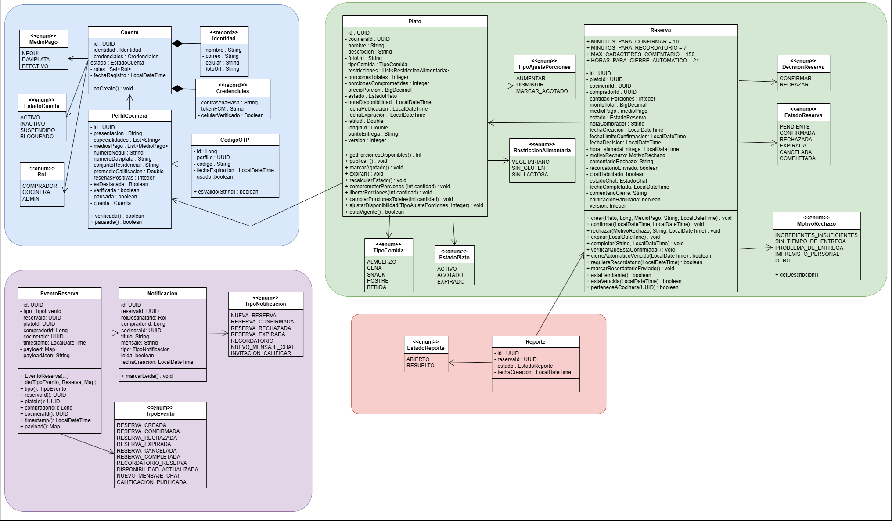
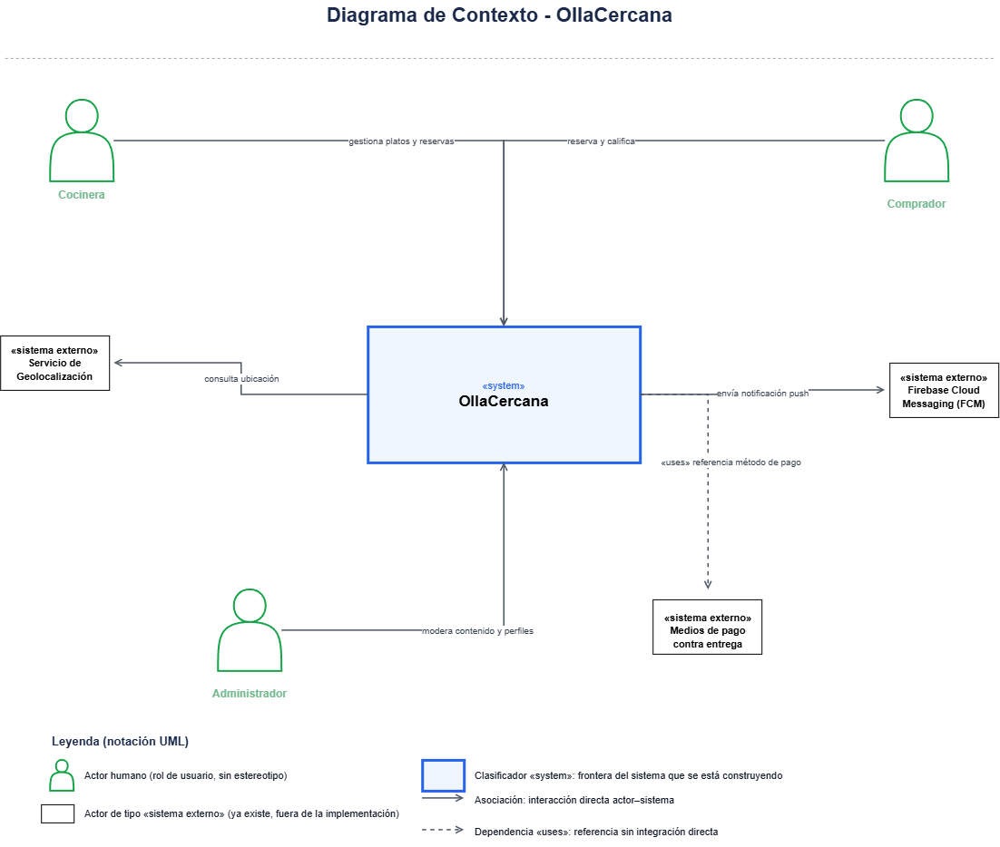
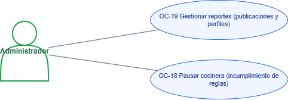
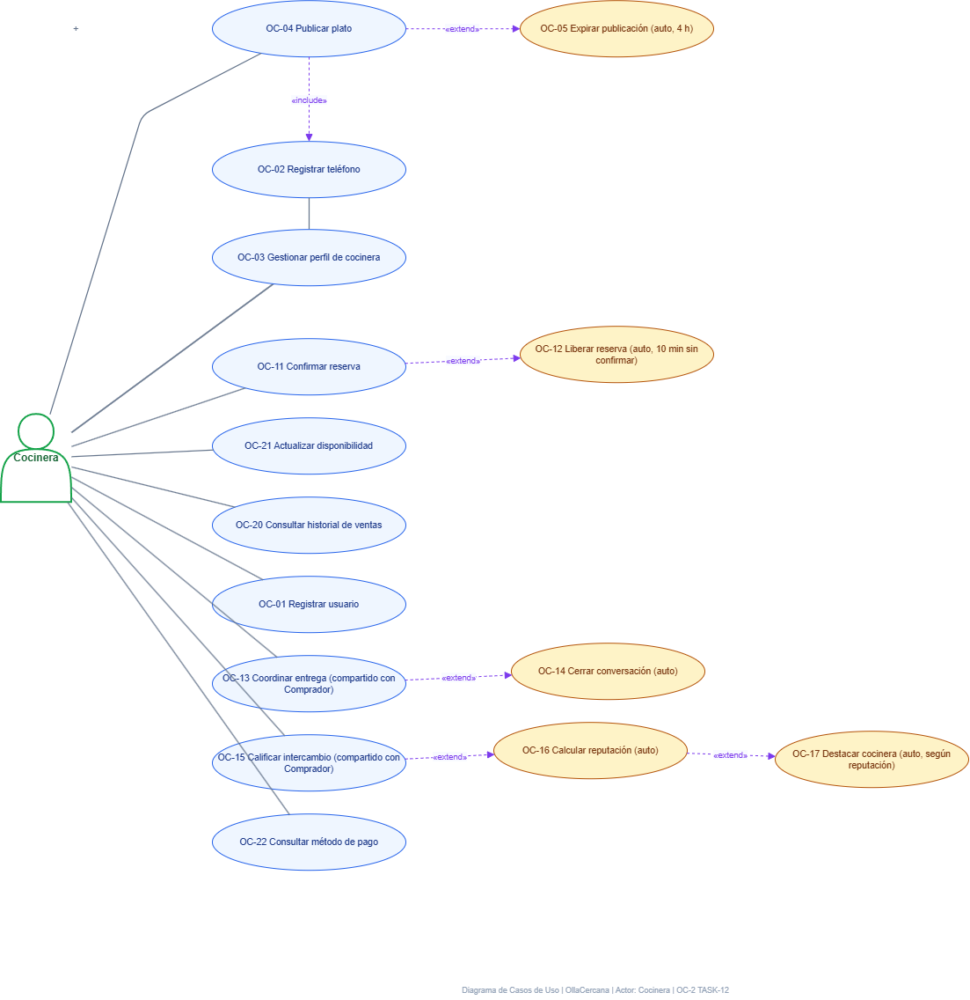
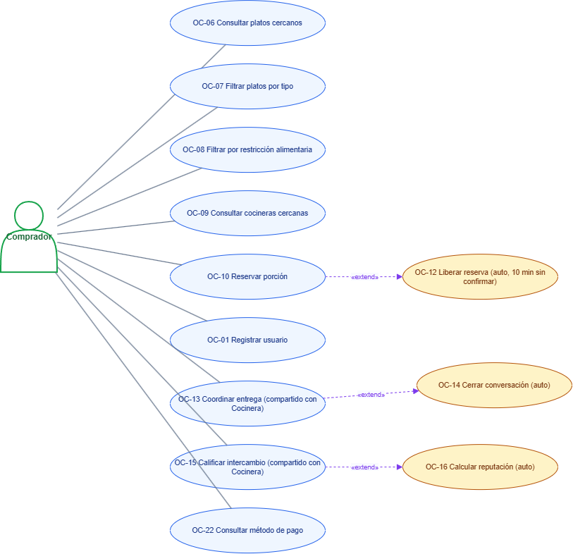

# OllaCercana

Aplicación backend para conectar cocineras locales con compradores que buscan comida casera cerca de ellos. Los compradores pueden reservar porciones de platos publicados, y las cocineras gestionan sus platos, disponibilidad y reservas.

---

## Tabla de contenidos

- [Stack tecnológico](#stack-tecnológico)
- [Cómo ejecutar el proyecto](#cómo-ejecutar-el-proyecto)
- [Estructura del proyecto](#estructura-del-proyecto)
- [Justificación de patrones de diseño](#justificación-de-patrones-de-diseño)
- [Diagramas](#diagramas)
- [Matriz de Roles y Permisos](#matriz-de-roles-y-permisos)
- [Reglas de negocio](#reglas-de-negocio)

---

## Stack tecnológico

- **Java 21** + **Spring Boot 3.2.5**
- **Spring Data JPA** + **PostgreSQL** (persistencia principal)
- **Spring Data MongoDB** (eventos de dominio y notificaciones)
- **Spring Security + JWT** (autenticación stateless con roles)
- **Lombok**, **MapStruct** / mappers manuales
- **JUnit 5 + Mockito** (pruebas unitarias)
- **Maven** (build)

---

## Cómo ejecutar el proyecto

### Requisitos previos

- JDK 17+
- Maven 3.9+
- PostgreSQL 14+ corriendo en `localhost:5432`
- MongoDB 6+ corriendo en `localhost:27017`

### Configuración

Crea la base de datos `ollacercana` en PostgreSQL:

```sql
CREATE DATABASE ollacercana;
```

Ajusta las credenciales en `src/main/resources/application.yml` si es necesario:

```yaml
spring:
  datasource:
    url: ${DB_URL:jdbc:postgresql://localhost:5432/ollacercana}
    username: ${DB_USERNAME:postgres}
    password: ${DB_PASSWORD:postgres}
  data:
    mongodb:
      uri: ${MONGO_URI:mongodb://localhost:27017/ollacercana}
```

### Ejecución

```bash
# Compilar y correr tests
mvn clean test

# Arrancar la app
mvn spring-boot:run
```

La API queda disponible en `http://localhost:8080`.

---

## Estructura del proyecto

```
src/main/java/com/ollacercana/
├── controller/          # Endpoints REST + interfaces OpenAPI (*Api.java)
├── dto/
│   ├── request/         # DTOs de entrada
│   └── response/        # DTOs de salida
├── exception/           # Excepciones de dominio y handler global
├── filter/              # JwtAuthenticationFilter
├── mapper/              # Mappers dominio ↔ entity / document
├── model/
│   └── domain/          # Entidades y value objects de dominio
├── persistence/
│   ├── document/        # Documentos MongoDB
│   └── entity/          # Entidades JPA
├── repository/
│   └── mongo/           # Repositorios MongoDB
├── security/            # JwtService, SecurityConfig, UserDetails
├── service/
│   ├── impl/            # Implementaciones
│   └── *.java           # Interfaces de servicio
├── util/                # Utilidades varias
└── validator/
    └── chain/           # Chain of Responsibility para validación
```

---

## Justificación de patrones de diseño

### Observer

Se aplica para desacoplar la publicación de eventos de dominio (cambios en reservas, disponibilidad de platos, chat) de las acciones que reaccionan a ellos (enviar push por FCM, guardar notificación in-app, difundir por WebSocket). El dominio publica el evento sin saber quién lo consume; la capa de aplicación define el contrato `ObservadorReserva`; la infraestructura implementa los notificadores concretos. Esto permite agregar nuevos canales de notificación sin modificar el dominio (**OCP**) y mantener bajo acoplamiento entre módulos (OC-015, OC-016).

### Factory Method

Se aplica para centralizar la creación de cuentas según su rol (`FabricaComprador`, `FabricaCocinera`, `FabricaAdministrador`). Encapsula las reglas de creación (validar unicidad de correo y celular, hashear contraseña, asignar rol inicial) en un único punto. Evita que los servicios construyan cuentas con `new` disperso y garantiza que toda cuenta creada cumpla las invariantes del dominio (OC-001).

### Chain of Responsibility

Se aplica para modelar el flujo de moderación de reportes y pausas por reputación. Cada eslabón (`ValidadorReporte`, `EvaluadorReputacion`, `OcultamientoPreventivo`, `RevisorAdministrador`) decide si puede manejar el caso o lo pasa al siguiente. Esto permite agregar reglas de moderación sin tocar las existentes, y separa la responsabilidad de cada paso: validar formato, evaluar reputación (RN-09), ocultar preventivamente (RN-22) y tomar la decisión final con justificación (RN-23) (OC-017, OC-018).

### Iterator / Composite

Se aplican conjuntamente para el catálogo de platos. **Composite** permite tratar un plato individual (`PlatoHoja`) o un grupo de platos (`GrupoPlatos`, agrupados por conjunto o cocinera) de forma uniforme, facilitando la organización jerárquica del catálogo. **Iterator** permite recorrer esa estructura aplicando filtros (tipo de comida, restricciones, precio, distancia) sin exponer la representación interna de la colección. Juntos resuelven la búsqueda y filtrado de platos de forma extensible y desacoplada (OC-006, OC-007, OC-008).

---

## Diagramas

### Diagrama de clases



### Diagrama C4



### Diagrama de Componentes Generales


### Diagrama de Componentes Específicos


### Diagrama de Casos de Uso — Administrador



### Diagrama de Casos de Uso — Cocinera



### Diagrama de Casos de Uso — Comprador



---

## Matriz de Roles y Permisos

La API implementa autenticación stateless mediante **JWT** y control de acceso basado en roles (`@PreAuthorize`). La identidad (`cuentaId`, `cocineraId` y `roles`) se extrae de forma segura a partir de los claims del token Bearer.

| Endpoint | Método | Roles Permitidos | Descripción / Regla |
|:---------|:-------|:-----------------|:--------------------|
| `/api/v1/sesiones` | `POST` | *Público* | Inicio de sesión, retorna JWT y lista de roles |
| `/api/v1/cuentas` | `POST` | *Público* | Registro de nueva cuenta (`COMPRADOR` o `COCINERA`) |
| `/api/v1/cuentas/{id}/avisos` | `PATCH` | `COMPRADOR`, `COCINERA` | Activar o desactivar avisos in-app (RN-26) |
| `/api/v1/perfiles` | `POST` | `COCINERA`, `ADMIN` | Creación de perfil con conjunto, especialidades y medios de pago |
| `/api/v1/perfiles/{id}` | `PUT` | `COCINERA`, `ADMIN` | Actualización de perfil de cocinera |
| `/api/v1/perfiles/{id}/verificar-telefono` | `POST` | `COCINERA`, `ADMIN` | Verificación de teléfono mediante código OTP (RN-01) |
| `/api/v1/perfiles/cuenta/{cuentaId}` | `GET` | `Autenticado` | Consulta de perfil asociado a una cuenta |
| `/api/v1/perfiles/destacadas` | `GET` | *Público* | Listado de cocineras destacadas (RN-10) |
| `/api/v1/platos/cercanos` | `GET` | *Público* | Catálogo geolocalizado con filtros de menú y restricciones (RN-05) |
| `/api/v1/platos/{id}` | `GET` | *Público* | Detalle del plato con medios de pago y nota contra entrega |
| `/api/v1/platos` | `POST` | `COCINERA` | Publicar nuevo plato del día (HU-04, RN-02, RN-27, RN-28) |
| `/api/v1/platos/{id}/disponibilidad` | `PATCH` | `COCINERA` | Ajustar porciones con bloqueo optimista (HU-24, RN-16, RN-27) |
| `/api/v1/platos/{id}` | `DELETE` | `COCINERA`, `ADMIN` | Eliminar plato (solo cocinera titular o admin) |
| `/api/v1/cocineras/mapa` | `GET` | *Público* | Mapa de cocineras activas con coordenadas ofuscadas a 100m (HU-09, RN-05) |
| `/api/v1/reservas` | `POST` | `COMPRADOR` | Crear reserva de porciones (HU-11, RN-03, RN-14, RN-15) |
| `/api/v1/reservas/pendientes` | `GET` | `COCINERA` | Listar solicitudes pendientes vigentes de su cocina (RN-04) |
| `/api/v1/reservas/{id}` | `GET` | `Autenticado` | Consultar reserva (solo comprador, cocinera titular o admin) |
| `/api/v1/reservas/{id}/decision` | `PATCH` | `COCINERA` | Confirmar o rechazar reserva (HU-12, RN-04) |
| `/api/v1/reservas/{id}/completar` | `POST` | `COMPRADOR`, `COCINERA` | Cerrar transacción con entrega y pago (HU-23, RN-32) |
| `/api/v1/reservas/{id}/mensajes` | `POST` | `COMPRADOR`, `COCINERA` | Enviar mensaje en el chat de la reserva activa (HU-13, RN-17) |
| `/api/v1/reservas/{id}/mensajes` | `GET` | `COMPRADOR`, `COCINERA` | Historial de chat con cursor (`?desde`) para polling (HU-13) |
| `/api/v1/reservas/{id}/mensajes/leidos` | `PATCH` | `COMPRADOR`, `COCINERA` | Marcar como leídos los mensajes de la contraparte |
| `/api/v1/reservas/{id}/mensajes/no-leidos` | `GET` | `COMPRADOR`, `COCINERA` | Conteo de mensajes no leídos de la reserva |
| `/api/v1/reservas/{reservaId}/calificacion` | `POST` | `COMPRADOR` | Calificar reserva completada (HU-15, RN-19, RN-20, RN-31) |
| `/api/v1/cocineras/{cocineraId}/calificaciones` | `GET` | *Público* | Listado paginado de reseñas públicas de la cocinera (HU-22) |
| `/api/v1/cocineras/{cocineraId}/calificaciones/resumen` | `GET` | *Público* | Resumen de reputación: promedio, total y positivas (HU-22) |
| `/api/v1/cocineras/metricas` | `GET` | `COCINERA` | Ingresos referenciales, porciones y plato más pedido (HU-20) |
| `/api/v1/cocineras/historial` | `GET` | `COCINERA` | Historial paginado de pedidos completados con calificación (HU-20) |
| `/api/v1/notificaciones` | `GET` | `Autenticado` | Listar notificaciones in-app del usuario (HU-17) |
| `/api/v1/notificaciones/{id}/leida` | `PATCH` | `Autenticado` | Marcar notificación in-app como leída (HU-17) |
| `/api/v1/notificaciones/no-leidas/conteo` | `GET` | `Autenticado` | Conteo de notificaciones no leídas para badges (HU-17) |
| `/api/v1/usuarios/{id}/medallas` | `GET` | *Público* | Consultar insignias vigentes de un usuario (HU-21) |
| `/api/v1/reportes` | `POST` | `COMPRADOR`, `COCINERA` | Reportar plato o cuenta por contenido indebido (HU-18, RN-22) |
| `/api/v1/reportes/motivos` | `GET` | *Público* | Listar motivos válidos de reporte (HU-18) |
| `/api/v1/admin/moderacion/reportes` | `GET` | `ADMIN` | Listado paginado de reportes con filtro por estado (HU-19) |
| `/api/v1/admin/moderacion/reportes/{reporteId}` | `GET` | `ADMIN` | Detalle y evidencias de un reporte (HU-19) |
| `/api/v1/admin/moderacion/reportes/{reporteId}/decision` | `POST` | `ADMIN` | Ejecutar decisión auditada sobre un reporte (HU-19, RN-23) |
| `/api/v1/admin/moderacion/perfiles/pausados` | `GET` | `ADMIN` | Listar perfiles pausados por baja reputación (HU-19, RN-09) |
| `/api/v1/admin/moderacion/perfiles/{cocineraId}/reactivar` | `POST` | `ADMIN` | Reactivar perfil pausado con justificación auditada (HU-19, RN-23) |
---

## Reglas de negocio

| Código | Regla |
| :---: | :--- |
| RN-03 | No se puede reservar si no hay porciones suficientes |
| RN-05 | Los platos se listan por cercanía geográfica |
| RN-09 | La reputación de una cocinera se ve afectada por reportes resueltos |
| RN-14 | Una cocinera no puede reservar sus propios platos |
| RN-15 | Un comprador no puede tener más de 2 reservas pendientes simultáneas |
| RN-22 | Ante reportes reiterados, el plato se oculta preventivamente |
| RN-23 | Toda decisión de moderación queda registrada con justificación |

---